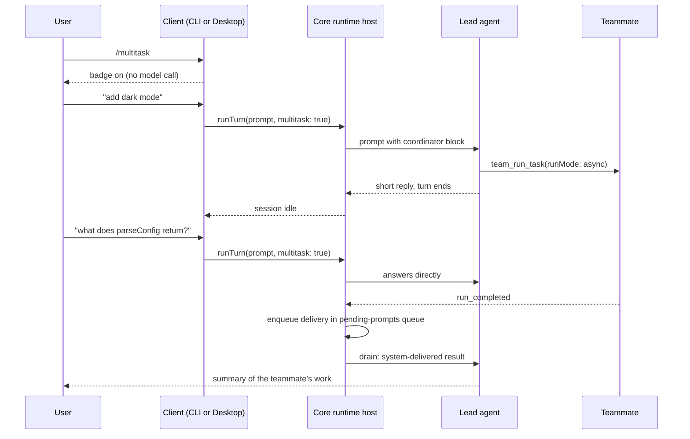

# Plan: the `/multitask` command

Status: proposed. Nothing in this document is implemented yet.

## 1. Goal

Today, when the lead agent hands work to a teammate, the chat is blocked until the teammate is done. The user can type, but their messages wait in a queue.

`/multitask` changes that for one session. The lead becomes a coordinator. It hands substantial work to a background teammate, tells the user what it did, and ends its turn right away. The user keeps chatting. When a teammate finishes, its result arrives in the chat as a new message, and the lead reports it.

This mirrors Cursor's Multitask Mode. It works in both Cline Desktop (`apps/examples/desktop-app`) and the CLI (`apps/cli`).

## 2. Non-goals

- No change to `/team`. With multitask off, `/team` behaves exactly as today.
- No new teammate tools. The lead uses the existing team tools (`team_spawn_teammate`, `team_run_task`, `team_cancel_run`, `team_list_runs`).
- No support in single-prompt CLI runs (`cline "..."`), ACP, the VS Code extension, or Desktop cloud sessions. `/multitask` is for interactive local sessions.
- No limit on how many teammates run at once beyond what the team runtime already enforces.

## 3. What the user sees

1. The user types `/multitask`. A short reply says "Multitask mode is on." A **Multitask** badge appears: in the CLI status bar under the model line, and in Desktop next to the Plan/Act toggle in the input bar.
2. The user asks for something big, for example "add dark mode to the settings page". The lead replies in a sentence or two ("I've handed this to a teammate, `ui-dev`; I'll report back when it's done.") and stops. The input is free at once.
3. The user asks a quick question, for example "what does `parseConfig` return?". The lead answers it directly, without a teammate.
4. When `ui-dev` finishes, a system-delivered message appears in the chat with the result, and the lead summarizes it for the user. If the user is in the middle of another exchange with the lead, the delivery waits until that exchange ends.
5. A follow-up such as "also add a toggle in the header" goes back to the same teammate, which keeps its earlier conversation.
6. `/multitask off` removes the badge. From the next message on, the lead behaves as it does today.

`/multitask` with no argument and `/multitask on` both turn the mode on. Any other argument prints a usage line.

## 4. How it works

### 4.1 The pieces

- **A per-turn flag.** Each user message carries `multitask: true | false`. It travels the same way the Plan/Act `mode` already travels: from the client, through `ClineCore.send`, over the Hub, to the core runtime host.
- **Coordinator instructions.** In a multitask turn, the core adds a fixed instruction block in front of the user's text (section 6). Display code hides the block, the same way it hides the mode-switch notice today.
- **No waiting.** In a multitask turn, the core skips its "wait for teammates, then continue" loop and lets the turn end. The session goes idle, so the next user message runs right away instead of queuing.
- **Delivery.** When a teammate run ends and the session is in multitask mode, the core puts a system-delivered message into the session's existing pending-prompts queue. The queue already runs prompts one after another, so a delivery never interrupts a running turn.

### 4.2 Flow



### 4.3 Where the mode lives

The client owns the on/off switch and sends it with every message. The core remembers the last value it saw on the active session and saves it in the session's metadata as `multitask: true`.

Why this split:

- **A per-turn field is the cheapest way across the Hub.** `run.start` already carries `mode` and `delivery` per turn (`sdk/packages/core/src/hub/server/handlers/run-handlers.ts`, lines 264–280). Adding one more field needs no new Hub command.
- **It works before the session exists on disk.** A new session has no stored row until its first message. A setting written by a separate "set mode" call would have nowhere to go. A flag sent with the message is applied after the core creates the row.
- **The core still needs to know between messages.** A teammate can finish while the user is silent. The core decides then whether to deliver a message, so it keeps `session.multitask` in memory.
- **Saving it in metadata covers a Hub restart.** When the Hub restarts, the core rebuilds the session from disk. It reads `metadata.multitask` back, so results of recovered teammate runs are still delivered without waiting for the user's next message.
- **Both clients restore the badge from the same place.** Desktop reads `metadata.multitask` when it opens or attaches a session, so the mode survives an app restart. The CLI reads it when it resumes a session. Otherwise the CLI keeps the switch in memory and starts with it off for a new session.

Only user messages change the stored value. System-delivered messages carry no flag, so a late delivery cannot turn the mode back on after the user turned it off.

## 5. What exists today

Paths are relative to the repository root.

### 5.1 `/team`

- CLI: `apps/cli/src/utils/team-command.ts` rewrites `/team <task>` into a `<user_command slash="team">` block with `formatUserCommandBlock`. `apps/cli/src/runtime/interactive/chat-command-runner.ts` (lines 51–66) calls it, and turns teams on with `restartEmpty()` if they were off. That starts a new, empty session.
- CLI command listing: `apps/cli/src/utils/chat-commands.ts` (`/team` at lines 443–460; `/yolo [on|off|toggle]` at lines 402–417 shows the on/off pattern), `apps/cli/src/tui/commands/slash-command-registry.ts` (`SYSTEM_COMMAND_ORDER`, lines 117–133), `apps/cli/src/tui/interactive-welcome.ts` (`builtins`, lines 115–141), and `apps/cli/src/tui/components/dialogs/help-dialog.tsx` (lines 166–171).
- Desktop: `apps/examples/desktop-app/sidecar/chat-session.ts` has `BUILTIN_SLASH_COMMAND_NAMES` (line 120) and `rewriteDesktopTeamPrompt` (lines 262–299). The latter refuses `/team` when the Teams tool is disabled or the mode's tool preset has no team tools. `/compact` is handled inside the sidecar without a model call (lines 1633–1655). The webview lists built-in commands in `BUILTIN_SLASH_COMMANDS` in `webview/components/views/chat/chat-input-bar.tsx` (lines 124–134).

### 5.2 Prompt helpers

`sdk/packages/shared/src/prompt/format.ts`:

- `formatUserInputBlock` wraps every model-bound user message in `<user_input mode="...">`.
- `formatModeSwitchNotice` produces a `<mode_notice>` element that is sent to the model, and `stripModeNotices` (lines 155–158) removes it at display time. `formatDisplayUserInput` (lines 179–193) and `deriveTitleFromPrompt` in `sdk/packages/core/src/services/session-data.ts` (lines 239–249) both call it. The VS Code extension calls it too.

### 5.3 Team tools

`sdk/packages/core/src/extensions/tools/team/team-tools.ts`:

- `team_run_task` (lines 495–561) runs a task on a teammate. `runMode: "async"` returns a `runId` at once; `sync`, the default, blocks the lead. `continueConversation: true` keeps the teammate's earlier conversation.
- `team_await_runs` (lines 598–633) blocks until runs finish.
- The `runMode` description in `sdk/packages/shared/src/team/schema.ts` (lines 130–132) tells the model to use `team_await_runs` to collect async results.

### 5.4 Why the chat blocks today

In `sdk/packages/core/src/runtime/host/local-runtime-host.ts`:

- `executeTurn` (lines 1987–2057) runs the lead, then loops while `shouldAutoContinueTeamRuns` is true (line 2042). Each pass waits in `waitForTeamRunUpdates` and continues the lead with `buildTeamRunContinuationPrompt`.
- `completeInteractiveTurn` (lines 2059–2067) returns early while `hasPendingTeamRunWork` is true, so the session never goes idle.
- `runTurn` (lines 1266–1352) queues any message that arrives while the agent cannot start a run (lines 1273–1308). After a turn, it drains the queue (lines 1328–1332).
- `abort` (lines 1365–1395) cancels all outstanding teammate work.

A third blocker is outside the host. `sdk/packages/core/src/runtime/orchestration/runtime-builder.ts` installs a `teamCompletionGuard` (lines 866–896). When the lead tries to finish while runs are active, it adds "Do NOT stop until all tasks are completed" and the agent loop keeps going (`sdk/packages/agents/src/agent-runtime.ts`, lines 962–976).

### 5.5 Teammate run tracking

- `trackTeamRunState` in `sdk/packages/core/src/session/team/team-session-coordinator.ts` (lines 15–53) keeps `activeTeamRunIds` and `pendingTeamRunUpdates` on the session. It is called from `AgentEventBridge.handleTeamEvent` (`sdk/packages/core/src/runtime/host/local/agent-event-bridge.ts`, lines 123–129). The host wires that through the `onTeamEvent` callback (local-runtime-host.ts, lines 755–758).
- `toTeamRunResultRecord` in `sdk/packages/core/src/extensions/tools/team/persistence-policy.ts` (line 124) already trims a run's final text to `TEAM_RUN_RESULT_TEXT_LIMIT` (4,000 characters).
- On restore, `AgentTeamsRuntime.recoverActiveRuns` (`sdk/packages/core/src/extensions/tools/team/multi-agent.ts`, line 1499) re-queues runs whose teammate was restored and marks the rest `interrupted`.

### 5.6 Pending-prompts queue

`PendingPromptsController` in `sdk/packages/core/src/runtime/turn-queue/pending-prompt-service.ts` stores entries (`PendingPromptEntry`, lines 16–23). `enqueue` (lines 256–280) schedules a drain. `drain` (lines 327–376) runs one entry at a time through `deps.send`, which is the host's `runTurn`. It only starts when `agent.canStartRun()` is true. Each drained entry emits `pending_prompt_submitted`, which both clients already render as a new turn.

### 5.7 How a turn reaches the core

- `SendSessionInput` in `sdk/packages/core/src/runtime/host/runtime-host.ts` (lines 268–276) carries `prompt`, `mode`, attachments and `delivery`.
- Both clients call `ClineCore.send`, which is the host's `runTurn`. Over the Hub this is `HubRuntimeHost.runTurn` (`sdk/packages/core/src/hub/runtime-host/hub-runtime-host.ts`, lines 1171–1200), which sends `run.start`.
- On the Hub, `run.start` and `session.send_input` share one handler in `run-handlers.ts` (lines 264–280). It builds a `SendSessionInput` and calls the local host's `runTurn`.
- `SessionClient.sendRuntimeSession` (`sdk/packages/core/src/hub/client/session-client.ts`, lines 404–425) is used by cron and the cloud controller, not by the two clients. It needs no change.

## 6. The coordinator instructions

New in `sdk/packages/shared/src/prompt/format.ts`. The block goes in front of the user's text in every multitask turn.

```ts
export const MULTITASK_INSTRUCTIONS = `Multitask mode is on. You coordinate background teammates while the user keeps chatting with you.
- Hand substantial work (code changes, investigations, anything needing more than a few tool calls) to a teammate. Use one coherent teammate by default: spawn it with team_spawn_teammate if no existing teammate fits, then call team_run_task with runMode "async".
- Use several teammates only for clearly independent workstreams that will not touch the same files.
- Do not redo or duplicate delegated work yourself.
- For a follow-up on work a teammate already did, reuse that teammate: call team_run_task with the same agentId and continueConversation true.
- Answer quick questions and trivial requests directly, without a teammate.
- Never wait for teammates. Do not call team_await_runs, do not sleep, and do not poll. After delegating, tell the user in one or two sentences what you handed off and to whom, then end your turn.
- Teammate results arrive later as system-delivered messages. When one arrives, tell the user the outcome briefly and decide whether follow-up work is needed.`;

export function formatMultitaskNotice(): string {
	return `<multitask_mode>${MULTITASK_INSTRUCTIONS}</multitask_mode>`;
}
```

`stripModeNotices` also removes `<multitask_mode>` elements:

```ts
export function stripModeNotices(input?: string): string {
	if (!input?.trim()) return "";
	return removeTagElements(
		removeTagElements(input, "mode_notice"),
		"multitask_mode",
	).trim();
}
```

That one change hides the block from transcripts, titles, session search and the VS Code message mapping.

## 7. Changes, file by file

### 7.1 Shared (`sdk/packages/shared`)

- `src/prompt/format.ts`: add `MULTITASK_INSTRUCTIONS` and `formatMultitaskNotice`, and extend `stripModeNotices` (section 6).
- `src/index.ts` and `src/index.browser.ts`: export them.

### 7.2 Core types and transport (`sdk/packages/core`)

- `src/runtime/host/runtime-host.ts`: add `multitask?: boolean` to `SendSessionInput`. Undefined means "keep the session's current value".
- `src/types/session.ts`:
  - add `multitask?: boolean` to `ActiveSession` and `PendingPrompt`;
  - add `text?: string` to `TeamRunUpdate`.
- `src/runtime/turn-queue/pending-prompt-service.ts`: add `multitask?: boolean` to `PendingPromptEntry`, `PendingPromptEnqueueInput`, the controller's `enqueue` input and `deps.send`. In `drain`, pass it on:

  ```ts
  const result = await this.deps.send({
  	sessionId,
  	prompt: next.prompt,
  	...(next.mode ? { mode: next.mode } : {}),
  	...(next.multitask !== undefined ? { multitask: next.multitask } : {}),
  	userImages: next.userImages,
  	userFiles: next.userFiles,
  });
  ```

- `src/hub/runtime-host/hub-runtime-host.ts`, `runTurn`: add `multitask: input.multitask` to the `run.start` payload.
- `src/hub/server/handlers/run-handlers.ts`: read it back.

  ```ts
  multitask: typeof payload.multitask === "boolean" ? payload.multitask : undefined,
  ```

### 7.3 Core run tracking and delivery

`src/session/team/team-session-coordinator.ts`:

- In `trackTeamRunState`, keep the run's trimmed final text on completed runs:

  ```ts
  text: toTeamRunResultRecord(event.run.result)?.text || undefined,
  ```

- Add `buildTeamRunDeliveryPrompt`, next to `buildTeamRunContinuationPrompt`. It returns plain text; `prepareTurnInput` wraps it when the queue drains it.

  ```ts
  export function buildTeamRunDeliveryPrompt(
  	session: ActiveSession,
  	updates: TeamRunUpdate[],
  ): string {
  	const blocks = updates.map((u) => {
  		const head = `- ${u.runId} (${u.agentId}) -> ${u.status}${u.error ? ` error=${u.error}` : ""}`;
  		return u.text ? `${head}\nResult:\n${u.text}` : head;
  	});
  	const remaining = session.activeTeamRunIds.size;
  	const instruction =
  		remaining > 0
  			? `${remaining} other teammate run(s) are still in progress. Their results will arrive the same way; do not wait for them.`
  			: "No teammate runs are in progress.";
  	return `System-delivered teammate async run updates:\n${blocks.join("\n\n")}\n\n${instruction} Tell the user the outcome briefly and decide whether follow-up work is needed.`;
  }
  ```

  The opening line matches the existing continuation prompt, so clients render both the same way.

### 7.4 Core runtime host (`src/runtime/host/local-runtime-host.ts`)

**Accept and remember the flag.** `runTurn` passes `input.multitask` into `executeTurn`, and into `pendingPromptsController.enqueue` when it queues the message. At the start of `executeTurn`, after `ensureSessionPersisted`:

```ts
if (input.multitask !== undefined && input.multitask !== (session.multitask === true)) {
	session.multitask = input.multitask;
	await this.persistSessionMetadata(session.sessionId, (current) => ({
		...(current ?? {}),
		...(session.sessionMetadata ?? {}),
		multitask: input.multitask,
	}));
}
const multitask = session.multitask === true;
```

**Add the coordinator block.** `prepareTurnInput` gets a `multitask` argument:

```ts
const prompt = formatModePrompt(
	multitask ? `${formatMultitaskNotice()}\n${enriched.prompt}` : enriched.prompt,
	input.mode ?? session.config.mode,
);
```

The steer path (`consumePendingUserMessage`, lines 984–991) does the same when `entry.multitask` is true.

**Do not wait.** In `executeTurn`:

```ts
while (!multitask && shouldAutoContinueTeamRuns(session, result.finishReason)) {
```

In `completeInteractiveTurn`:

```ts
if (!session.multitask && hasPendingTeamRunWork(session)) return;
```

**Let the lead finish.** Where the agent config is built (line 983), skip the team completion guard while the session is in multitask mode:

```ts
completionPolicy: runtime.completionPolicy && {
	...runtime.completionPolicy,
	completionGuard: () =>
		activeSessionRef?.multitask
			? undefined
			: runtime.completionPolicy?.completionGuard?.(),
},
```

**Deliver results.** A new private method, called from the `onTeamEvent` callback right after `handleTeamEvent`. `trackTeamRunState` runs synchronously at the start of `handleTeamEvent`, so the update is already recorded at that point.

```ts
private deliverMultitaskTeamRunUpdates(sessionId: string): void {
	const session = this.sessions.get(sessionId);
	if (!session?.multitask || session.pendingTeamRunUpdates.length === 0) return;
	const updates = session.pendingTeamRunUpdates.splice(0);
	this.pendingPromptsController.enqueue(sessionId, {
		prompt: buildTeamRunDeliveryPrompt(session, updates),
		delivery: "queue",
	});
}
```

The entry has no `multitask` field, so the drained turn uses the session's current value (section 4.3). `executeTurn` also calls this method once after it switches a session into multitask mode. That flushes updates that piled up while the mode was off.

**Keep teammates running on abort.** In `abort`, skip `teamRuntime.cancelOutstandingWork` and the clearing of run state when `session.multitask` is true. Esc then stops only the lead's current turn (section 8).

**Restore on resume.** When building `ActiveSession` (lines 1074–1106), set `multitask: initialSessionMetadata?.multitask === true`.

### 7.5 CLI (`apps/cli`)

- New `src/utils/multitask-command.ts`, next to `team-command.ts`:

  ```ts
  export const MULTITASK_COMMAND_USAGE =
  	"Usage: /multitask [on|off]\nRuns big tasks on background teammates so you can keep chatting.";

  export function parseMultitaskCommand(
  	input: string,
  ): { kind: "none" } | { kind: "usage" } | { kind: "set"; enabled: boolean } {
  	const match = /^\/multitask\b([\s\S]*)$/i.exec(input.trim());
  	if (!match) return { kind: "none" };
  	const arg = match[1].trim().toLowerCase();
  	if (arg === "" || arg === "on") return { kind: "set", enabled: true };
  	if (arg === "off") return { kind: "set", enabled: false };
  	return { kind: "usage" };
  }
  ```

- `src/runtime/interactive/chat-command-runner.ts`: handle it before `/team`. It takes a new `multitaskRef: { current: boolean }` and an `onMultitaskChanged` callback. Turning on with teams disabled (for example under `--yolo`) sets `config.enableAgentTeams = true` and a team name, like `/team`, but calls `restartWithCurrentMessages()` instead of `restartEmpty()`, so the conversation is kept. Add `restartWithCurrentMessages` to `InteractiveChatCommandRuntime`; the session runtime already returns it. The reply is "Multitask mode is on." or "Multitask mode is off."
- `src/runtime/run-interactive.ts`:
  - own `multitaskRef`;
  - pass `multitask: multitaskRef.current` in both `sendCurrentTurn` calls inside `sendTurnWithActModeContinuation` (lines 656–669);
  - add a `setMultitaskChangeNotifier`, shaped like `setModeChangeNotifier` (lines 854–856), so the TUI can show the badge;
  - when resuming a session, seed `multitaskRef` from `metadata.multitask` of the resumed session row.
- `src/runtime/interactive/session-runtime.ts`: add `multitask?: boolean` to `CurrentTurnInput`. `sendCurrentTurn` already spreads it into `manager.send`.
- `src/tui/components/status-bar.tsx`: add a `multitask: boolean` prop. When it is true, render a `● Multitask` line in the act accent above the auto-approve line.
- `src/tui/commands/slash-command-registry.ts`: add `"multitask"` to `SYSTEM_COMMAND_ORDER` after `"team"`.
- `src/tui/interactive-welcome.ts`: add `{ name: "multitask", instructions: "/multitask [on|off]", description: "Run big tasks on background teammates" }`.
- `src/tui/components/dialogs/help-dialog.tsx`: add a `/multitask` entry after `/team`.
- `src/utils/chat-commands.ts`: register `/multitask` like `/team`, with a reply that it must be entered directly in the interactive chat.
- `src/main.ts`: in single-prompt mode, reject `/multitask` with "/multitask is only available in interactive mode."

### 7.6 Desktop (`apps/examples/desktop-app`)

- `sidecar/types.ts`: add `multitask?: boolean` to `LiveSession`.
- `sidecar/chat-session.ts`:
  - add `"multitask"` to `BUILTIN_SLASH_COMMAND_NAMES`;
  - pull the availability checks out of `rewriteDesktopTeamPrompt` into `assertDesktopTeamsAvailable(availability)`, so `/team` and `/multitask` share them;
  - in `handleSendOnce`, next to the `/compact` branch, handle `/multitask`: refuse cloud bindings, check availability when turning on, set `session.multitask`, emit `chat_command_output` and a new `multitask_state` event `{ sessionId, enabled }`, then return `{ sessionId, ok: true, commandHandled: true, multitask }`;
  - pass `multitask: session?.multitask === true` to both `manager.send` calls (the queued one, lines 1790–1796, and the direct one, lines 1849–1855);
  - in `handleAttach` and the resume branch of session start, set `multitask` from `metadata.multitask` and include it in the response.
- `webview/hooks/use-chat-session.ts`: keep `multitaskEnabled` for the active session. Set it from start and attach responses and from `multitask_state` events.
- `webview/components/views/chat/chat-input-bar.tsx`:
  - add `{ name: "multitask", description: "Run big tasks on background teammates" }` to `BUILTIN_SLASH_COMMANDS`;
  - render a small **Multitask** badge next to the Plan/Act toggle while it is on.

## 8. Edge cases

- **Turned off while teammates run.** Turning the mode off does not stop teammates. Until the user sends the next message, results are still delivered as messages. That message carries `multitask: false`. From then on the lead is back to today's behavior: its turn waits for the runs that are still active. The off reply says how many runs are still going, so this is not a surprise.
- **Abort (Esc).** In multitask mode, Esc stops only the lead's current turn. Background teammates keep running, and their results are still delivered. To stop a teammate, the user asks the lead, which calls `team_cancel_run`. Closing the session (`/clear`, quit, delete) shuts the team runtime down as today.
- **Lead errors.** A turn that ends in error does not drain the queue (existing rule in `runTurn`). Deliveries stay queued and run after the next successful turn or the next enqueue, like queued user prompts today.
- **Teammate fails, is cancelled or is interrupted.** The delivery lists the status and the error. The lead tells the user and decides whether to retry.
- **Delivery while the user is typing or mid-turn.** It joins the queue behind any user prompts already queued, so the order stays fair. Like any queued prompt, it is visible in the queue UI and can be removed there.
- **Lead calls `team_await_runs` or uses `sync` anyway.** The instructions forbid it, but the tools still exist. The lead's turn then blocks as today. The user can still type, and their messages queue. See open question 2.
- **Teammate needs a tool approval while the lead is idle.** The approval wrapper (local-runtime-host.ts, lines 957–978) sets the session to `pending` and then always back to `running`. If teammate approvals go through this wrapper, an idle session would be left showing `running`. Check this during implementation; if so, restore the previous status instead of always `running`.
- **Hub restart with active runs.** The core rebuilds the session from disk and reads `metadata.multitask`. Team persistence re-queues runs whose teammate was restored, and their results are delivered when they finish. Runs that recovery marks `interrupted` emit their event while the runtime is being built, before the session is registered, so `trackTeamRunState` misses them. Hold team events that arrive before registration and replay them afterwards, the same way `heldSessionEvents` already does for plugin events (lines 1126–1136).
- **Session restarts from the client.** The CLI restarts the session on a Plan/Act switch or a model switch (`restartWithCurrentMessages`). That shuts the team runtime down and rebuilds it. Verify in the smoke test that active runs are recovered; see open question 3.
- **Teams tool disabled, or no team tools in the mode.** Desktop refuses `/multitask` with the same messages `/team` uses. The CLI turns teams on as described in section 7.5.
- **Plan mode.** Team tools exist in plan mode, so multitask works. Teammates build their tools with the session's mode, so in plan mode they are read-only too.
- **`--yolo`.** The yolo preset turns teams off. `/multitask` turns them on for the session, keeping the conversation. Teammates then run with auto-approval like the lead.
- **`/team` while multitask is on.** The `/team` prompt is sent as a multitask turn, so the lead spawns the team, does not wait, and results arrive as deliveries. With multitask off, `/team` is unchanged.
- **Non-interactive sessions.** `finalizeSingleRun` is untouched. `/multitask` is only accepted in interactive sessions.

## 9. Tests to add

- `sdk/packages/shared/src/prompt/format.test.ts`:
  - `formatMultitaskNotice` survives `normalizeUserInput`;
  - `stripModeNotices` and `formatDisplayUserInput` remove it.
- `sdk/packages/core/src/services/session-data.test.ts`: `deriveTitleFromPrompt` ignores the block.
- `sdk/packages/core/src/session/team/team-session-coordinator.test.ts`:
  - `trackTeamRunState` keeps trimmed result text;
  - `buildTeamRunDeliveryPrompt` lists status, error, text and the remaining count.
- `sdk/packages/core/src/runtime/turn-queue/pending-prompt-service.test.ts`: `multitask` on an entry reaches `deps.send`, and an entry without it sends none.
- `sdk/packages/core/src/runtime/host/local-runtime-host.test.ts`, following the existing "System-delivered teammate async run updates" test (around line 7600):
  - a multitask turn with an active run returns after one lead call, and the session goes `idle`;
  - a `run_completed` while idle enqueues a delivery, which drains into a new turn whose prompt holds the result text;
  - a `run_completed` during a running turn is delivered only after that turn ends;
  - `multitask: false` keeps today's wait-and-continue loop (the existing test stays green);
  - abort in multitask mode leaves teammate runs running;
  - the flag is written to metadata and restored from it on resume;
  - the completion guard is skipped in multitask mode and still applies otherwise;
  - the coordinator block is in the model-bound prompt but not in the session title.
- `sdk/packages/core/src/hub/server/handlers/run-handlers.test.ts`: `run.start` forwards `multitask`.
- `sdk/packages/core/src/hub/runtime-host/hub-runtime-host.test.ts`: `runTurn` sends `multitask`.
- `apps/cli/src/utils/multitask-command.test.ts` (new): no argument, `on`, `off`, a bad argument, and a non-matching prompt.
- `apps/cli/src/runtime/interactive/chat-command-runner.test.ts`:
  - on and off replies;
  - with teams disabled, turning on calls `restartWithCurrentMessages` and not `restartEmpty`.
- `apps/cli/src/tui/commands/slash-command-registry.test.ts`: `/multitask` is listed after `/team`.
- `apps/examples/desktop-app/sidecar/chat-session.test.ts`:
  - `/multitask` is handled without calling `manager.send`;
  - later sends pass `multitask: true`;
  - it is refused when the Teams tool is disabled;
  - attach restores it from metadata.
- `apps/examples/desktop-app/webview/components/views/chat/chat-input-bar.test.tsx`: the slash menu lists `/multitask`, and the badge shows when it is on.

## 10. How to verify

1. Unit tests:
   - `bun run build:sdk` from the repository root;
   - then `bun run test:unit` in `sdk/packages/shared`, `sdk/packages/core` and `apps/cli`;
   - then `bun run test:sidecar` in `apps/examples/desktop-app`.
2. `bun run check` from the repository root.
3. `just build` from the repository root, then start the installed Desktop build.
4. Desktop smoke test:
   1. Open a local session and type `/multitask`. The badge appears.
   2. Ask for a multi-file change. The lead delegates and ends its turn within seconds. The input is free.
   3. Ask a quick question while the teammate works. It is answered directly.
   4. Wait. A system-delivered message arrives with the result, and the lead summarizes it.
   5. Ask a follow-up. The same teammate is reused, with `continueConversation`.
   6. Press Esc during a lead turn. The teammate keeps running.
   7. Quit and reopen the app. The badge is still on for that session.
   8. Type `/multitask off`. The badge goes away, and the next big request blocks as today.
5. CLI smoke test, with `bun run dev` in `apps/cli`:
   1. Repeat steps 1–5 and 8 above, and check the status bar badge.
   2. Switch Plan/Act while a teammate runs, and check that the run is recovered and delivered.
   3. Start with `--yolo` and type `/multitask`. Teams are turned on, and the conversation is kept.

## 11. Open questions

1. Should a second Esc while the lead is idle stop all background teammates? This plan leaves them running and relies on asking the lead.
2. Should multitask turns hide `team_await_runs` from the lead and make `async` the default `runMode`, instead of relying on the instructions? Hiding is more reliable, but tools are fixed per agent today, so it needs per-turn tool filtering.
3. If CLI Plan/Act or model switches lose active runs, should the CLI block those switches while runs are active, or warn and continue?
4. Should deliveries look different from user messages, for example a compact "Teammate finished" row? This plan reuses how the existing system-delivered continuation already renders.
